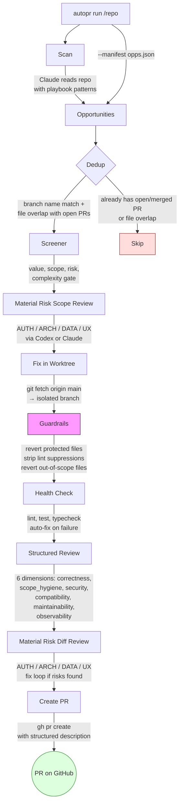
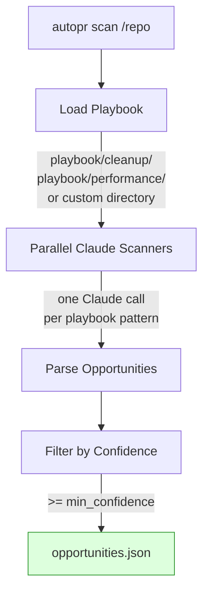
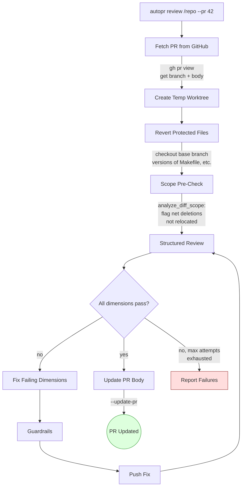
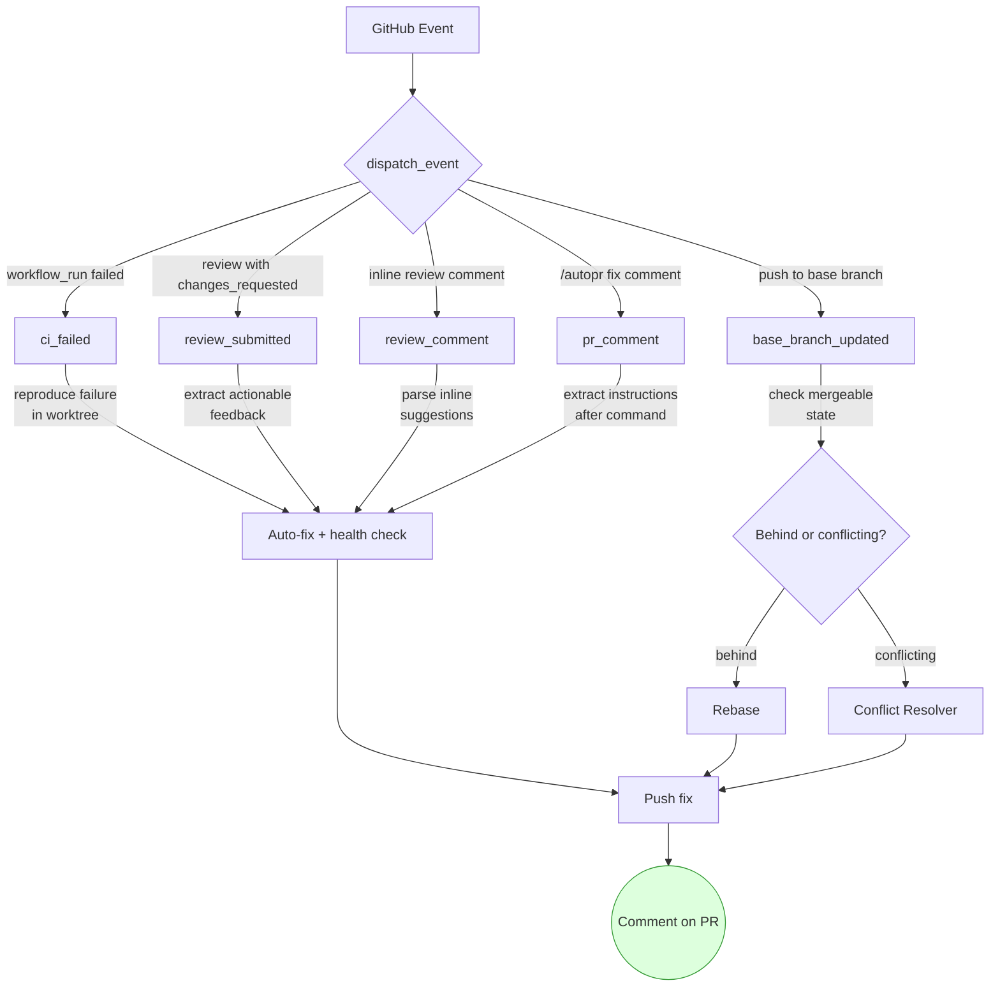
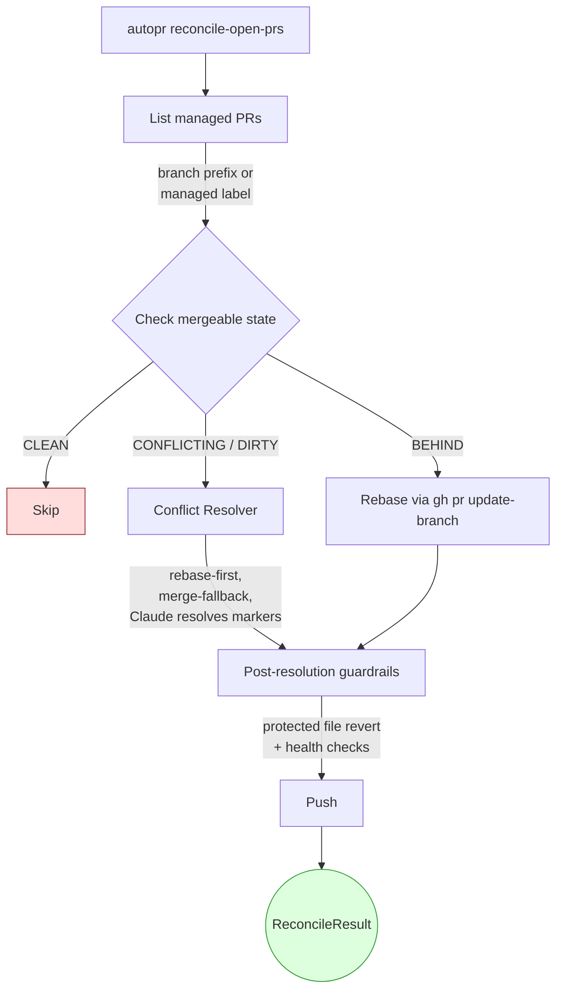
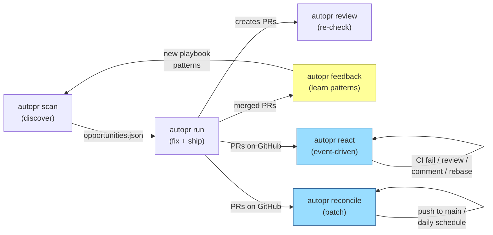

# autopr

Autonomous PR generation for codebases. Uses the Claude Code CLI to scan repos for improvement opportunities and generate fixes, and Codex (or Claude) to independently review them with mechanical guardrails, run health checks, and create pull requests.

## Why it's different

- **Protected files are reverted** — Makefile, CI configs, package.json, Dockerfile, etc. are automatically reverted before every commit, regardless of what the model changed.
- **Lint suppressions are stripped** — `# type: ignore`, `# noqa`, `// eslint-disable`, `// @ts-ignore` added by the fixer are automatically reverted, so fixes can't pass by silencing the linter.
- **Out-of-scope changes are reverted** — files modified outside the opportunity's stated scope are reverted before commit.
- **Health checks gate every fix** — your configured lint/test commands run on the fix, with a bounded number of fix attempts.
- **Structured 6-dimension review** — correctness, scope_hygiene, security, compatibility, maintainability and observability are each reviewed; failing dimensions go back through a fix loop.
- **Material-risk review** — a second reviewer (Codex by default, or Claude) checks AUTH / ARCH / DATA / UX risks in the scope and in the final diff.

## Status

Personal project, provided as-is. Issues are welcome, but no support is promised.

## Architecture

### `autopr run` — full pipeline



### `autopr scan` — discover opportunities



### `autopr review` — re-check existing PR



### `autopr react` — event-driven PR maintenance



### `autopr reconcile-open-prs` — batch PR reconciliation



### `autopr research` (under development)

Iterative performance research against live preview deployments. Deploys candidates, benchmarks with Lighthouse, and keeps only changes that measurably improve metrics.

### How the pieces connect



### Guardrails (mechanical, not LLM-dependent)

- **Protected files** — Makefile, CI configs, package.json, Dockerfile, etc. are automatically reverted before every commit
- **Lint suppression stripping** — `# type: ignore`, `# noqa`, `// eslint-disable`, `// @ts-ignore` added by the fixer are automatically reverted
- **Scope pre-check** — `analyze_diff_scope` parses the diff and flags deleted code blocks not relocated elsewhere, injected into the reviewer prompt
- **Out-of-scope file reversion** — Files modified outside the opportunity's stated scope are reverted before commit
- **Three-dot diff** — All comparisons use `git diff base...HEAD` (merge-base) to match what GitHub shows
- **File overlap dedup** — Opportunities touching files already modified by an open PR are skipped to prevent merge conflicts
- **Fresh fetch** — Worktrees branch from `origin/<base_branch>` after fetching, never stale local state

### Two-layer review

The material-risk reviewer backend is configurable — Codex (default) or Claude:

```yaml
gating:
  review_model: ""                 # empty = Codex
  review_model: "claude-opus-4-6"  # use Claude instead
```

Both backends feed into the same parser, which handles JSON and natural language (`[P1]/[AUTH]/[ARCH]` markers).

### Maintainer Mode

After `autopr run` creates PRs, the maintainer surface keeps them alive until merge:

- **`autopr init --workflows`** generates GitHub Actions workflows that call `react` and `reconcile-open-prs` on the target repo
- **Reactor** (`autopr react`) handles events as they arrive:
  - CI failures — reproduces the failure in a worktree, auto-fixes, re-runs health checks
  - Review feedback — extracts actionable comments, applies fixes
  - PR comments — responds to `/autopr fix` commands with instructions
  - Base branch updates — rebases or resolves conflicts to keep the PR current
- **Reconciler** (`autopr reconcile-open-prs`) runs on push-to-main and a daily schedule:
  - Lists all PRs with managed branch prefixes (`autopr/`) or managed labels
  - Rebases PRs that are behind, resolves conflicts for dirty PRs
- **Conflict resolver** uses a rebase-first, merge-fallback strategy:
  1. Attempt `git rebase origin/<base>`
  2. If conflicts arise, invoke Claude to resolve conflict markers
  3. If rebase fails entirely, fall back to `git merge --no-commit`
  4. Post-resolution guardrails: revert protected files, run health checks
- **Loop guard** — `max_cumulative_workflow_runs` caps total react workflow invocations per PR to prevent runaway fix loops

### Playbook structure

Playbooks are organized by purpose. Use `--playbook` to target a folder:

```
playbook/
  cleanup/           autopr run /repo --playbook playbook/cleanup/
    unused-files.md
    commented-code.md
    duplicate-code.md
    dead-code.md
  performance/       autopr run /repo --playbook playbook/performance/
    batch-queries.md
    n-plus-one.md
    redundant-lookups.md
    serial-hot-path-io.md
    blocking-loading-gate.md
    first-paint-client-fetch.md
```

## Research Mode (under development)

Iterative performance research against live preview deployments. Deploys candidates, benchmarks with Lighthouse, and keeps only changes that measurably improve metrics.

## Prerequisites

- Python 3.11+
- [Claude Code CLI](https://docs.anthropic.com/en/docs/claude-code) (`claude` command available)
- [GitHub CLI](https://cli.github.com/) (`gh` command, authenticated)
- Git
- Optional: [OpenAI Codex CLI](https://github.com/openai/codex) for material-risk reviews

## Installation

```bash
pip install -e '.[dev]'
```

## Quick Start

### 1. Initialize config

```bash
autopr init /path/to/your/repo
```

### 2. Scan for opportunities

```bash
autopr scan /path/to/repo -o opportunities.json

# Focus on performance patterns only
autopr scan /path/to/repo --playbook playbook/performance/ -o perf-opps.json
```

### 3. Run the full pipeline

```bash
# Auto-scan and fix everything
autopr run /path/to/repo

# Use a pre-built manifest (skip scanning)
autopr run /path/to/repo --manifest opportunities.json

# Dry run (no push, no PRs)
autopr run /path/to/repo --dry-run

# Only specific patterns
autopr run /path/to/repo --patterns unused_file,n_plus_one

# Only cleanup patterns
autopr run /path/to/repo --playbook playbook/cleanup/

# Skip material-risk review
autopr run /path/to/repo --no-mat-rev

# Use Claude instead of Codex for material-risk review
autopr run /path/to/repo --review-model claude-opus-4-6
```

### 4. Re-review an existing PR

```bash
autopr review /path/to/repo --pr 42 --update-pr
```

## Configuration

`autopr.yaml` controls all behavior. Generate one with `autopr init`, or copy `autopr.example.yaml` to `autopr.yaml` and edit it:

```yaml
repo:
  path: "/path/to/repo"
  remote_url: "https://github.com/org/repo"
  base_branch: "main"
  branch_prefix: "autopr/"
  health_checks:
    commands:
      - "make check"
      - "make test"
    timeout_seconds: 300
    max_fix_attempts: 3
  protected_files:
    - "Makefile"
    - "pyproject.toml"
    - "package.json"
    - "Dockerfile"
    - ".github/**"
  include_paths:
    - "src"
  min_confidence: 0.8

model: "claude-opus-4-6"
reviewer_model: "claude-opus-4-6"

automation:
  tool_repo: "org/autopr"
  tool_ref: "main"
  ci_workflow_names: ["CI"]
  comment_command: "/autopr fix"
  managed_branch_prefixes: ["autopr/"]
  auto_resolve_conflicts: true
  reconcile_behind_prs: true
  max_cumulative_workflow_runs: 5
  max_event_fix_attempts: 2
  max_conflict_retries: 2

gating:
  enable_screener: true
  enable_material_review: true
  review_model: ""                 # empty = Codex; "claude-opus-4-6" = Claude
  verdict_rules:
    - dimension: correctness
      on_fail: reject
    - dimension: scope_hygiene
      on_fail: reject
    - dimension: security
      on_fail: reject
    - dimension: compatibility
      on_fail: reject
    - dimension: maintainability
      on_fail: request_changes
    - dimension: observability
      on_fail: warn
```

## CLI Reference

### `autopr run`

| Flag | Default | Description |
|------|---------|-------------|
| `--config / -c` | -- | YAML config file |
| `--manifest / -m` | -- | JSON manifest (skip scanning) |
| `--playbook / -p` | built-in | Path to playbook directory |
| `--patterns` | all | Comma-separated pattern IDs |
| `--model` | claude-opus-4-6 | Model for scanning/fixes |
| `--reviewer-model` | claude-opus-4-6 | Model for structured review |
| `--review-model` | -- | Model for material-risk review (empty = Codex) |
| `--no-screen` | false | Skip pre-fix screener |
| `--no-mat-rev` | false | Skip material-risk review |
| `--dry-run` | false | Don't push or create PRs |
| `--verbose / -v` | false | Verbose output |

### `autopr scan`

| Flag | Default | Description |
|------|---------|-------------|
| `--model` | claude-opus-4-6 | Model for scanning |
| `--playbook / -p` | built-in | Path to playbook directory |
| `--patterns` | all | Comma-separated pattern IDs |
| `--output / -o` | opportunities.json | Output file |

### `autopr review`

| Flag | Default | Description |
|------|---------|-------------|
| `--pr` | -- | PR number to review |
| `--model` | claude-opus-4-6 | Model for review |
| `--update-pr` | false | Update PR body with AI Review section |
| `--max-fix-attempts` | 3 | Max fix attempts for failing dimensions |

### `autopr react`

| Flag | Default | Description |
|------|---------|-------------|
| `--event` | -- | Event type: `ci_failed`, `review_submitted`, `review_comment`, `pr_comment`, `base_branch_updated` |
| `--pr` | -- | PR number |
| `--head-branch` | -- | PR head branch name |
| `--head-sha` | -- | Current HEAD SHA of the PR branch |
| `--base-branch` | main | Base branch name |
| `--check-name` | -- | Name of the failed CI check (for `ci_failed`) |
| `--check-conclusion` | -- | Conclusion of the CI check (for `ci_failed`) |
| `--comment-body` | -- | Body of the triggering comment or review |
| `--comment-id` | -- | ID of the triggering comment |
| `--comment-author` | -- | Author of the triggering comment |
| `--review-id` | -- | ID of the triggering review |
| `--review-state` | -- | State of the review (e.g. `changes_requested`) |
| `--created-at` | -- | ISO timestamp of the triggering comment |
| `--model` | claude-opus-4-6 | Claude model for fixes |
| `--config / -c` | -- | YAML config file |
| `--dry-run` | false | Don't push or modify anything |
| `--verbose / -v` | false | Verbose output |

### `autopr reconcile-open-prs`

| Flag | Default | Description |
|------|---------|-------------|
| `--base-branch` | main | Base branch name |
| `--model` | claude-opus-4-6 | Claude model for conflict resolution |
| `--config / -c` | -- | YAML config file |
| `--dry-run` | false | Don't push or modify anything |
| `--verbose / -v` | false | Verbose output |

### `autopr init`

Generate a default `autopr.yaml` for a repository.

| Flag | Default | Description |
|------|---------|-------------|
| `--config / -c` | -- | Output config path (defaults to `<repo>/autopr.yaml`) |
| `--workflows/--no-workflows` | --workflows | Generate GitHub Actions workflow files for react and reconcile |

## Running on a Server

```bash
0 2 * * * autopr run /path/to/repo --config autopr.yaml >> /var/log/autopr.log 2>&1
```

Ensure `claude` and `gh` CLIs are authenticated on the server.

## License

MIT — see [LICENSE](LICENSE).
